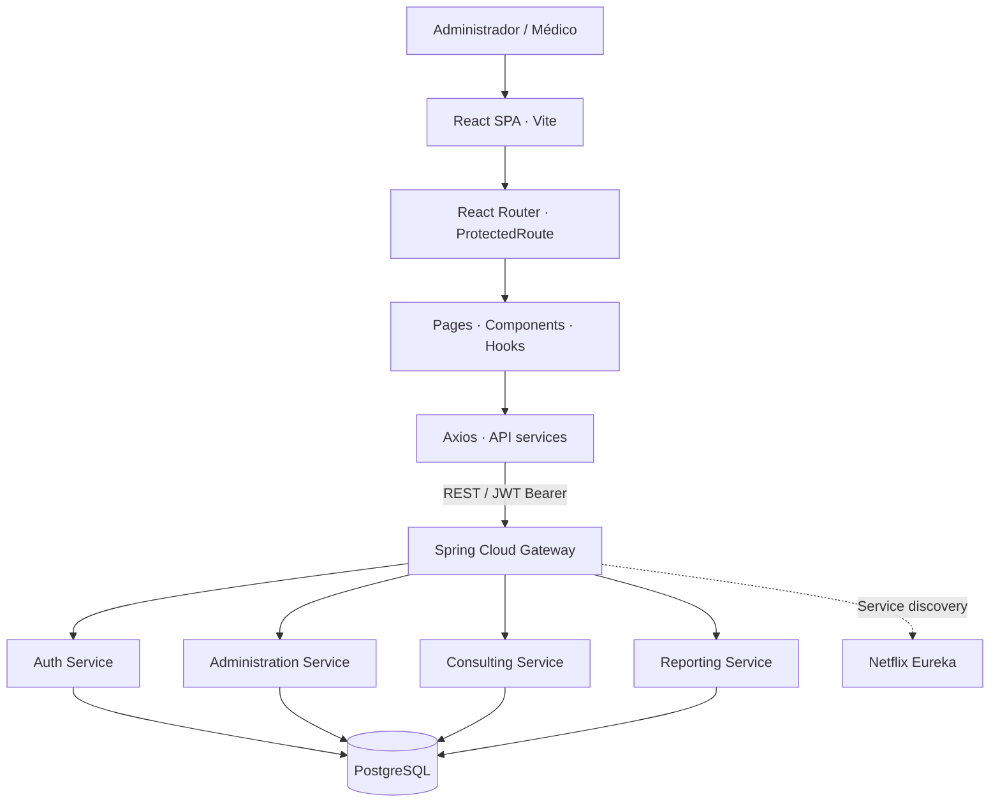
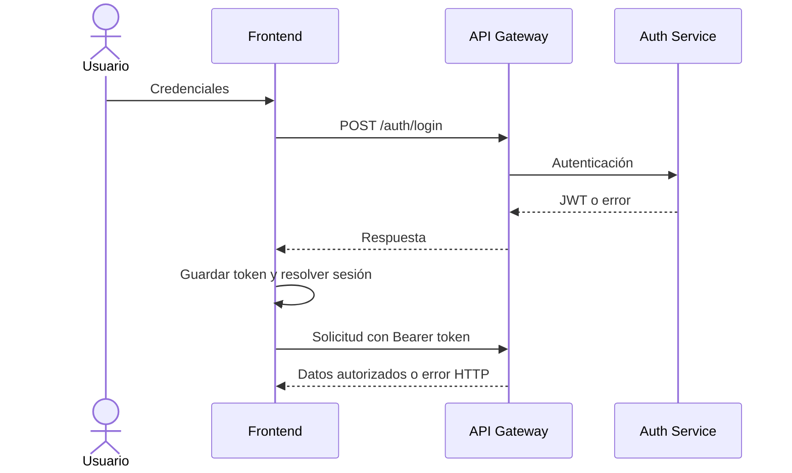

<div align="center">
  
  <h1>HQ Hospital — Frontend</h1>
  <p><strong>Hospital Management System</strong></p>
  <p>Plataforma web para la administración hospitalaria, la gestión de consultas médicas y el análisis de información clínica y operativa.</p>
  
  
  
  
  
  
  <p><a href="https://github.com/JosueGarciaAbata/hospital-management-system">Backend</a> · <a href="#instalación-y-ejecución">Instalación</a> · <a href="#arquitectura">Arquitectura</a> · <a href="#integración-con-la-api">API</a></p>
</div>

---

## Descripción general

**HQ Hospital** es el frontend de un sistema de gestión hospitalaria basado en microservicios. Proporciona una interfaz centralizada para que administradores y médicos puedan gestionar los procesos correspondientes a sus responsabilidades, consultar información y acceder a herramientas de seguimiento y reportes.

El proyecto está construido como una Single Page Application (SPA) con React y Vite. Consume los servicios del backend mediante una API Gateway, separando la presentación, la gestión de estado del cliente y la lógica de negocio del servidor.

> [!IMPORTANT]
> La rama [`develop`](https://github.com/DavidJosueP2/Hospital-Front/tree/develop) contiene los módulos funcionales descritos en esta documentación. La rama `main` conserva una versión inicial de la interfaz con un playground de componentes y navegación preliminar. Para ejecutar el sistema hospitalario, utiliza `develop`.

## Contenido

- [Funcionalidades](#funcionalidades)
- [Roles y permisos](#roles-y-permisos)
- [Stack tecnológico](#stack-tecnológico)
- [Arquitectura](#arquitectura)
- [Estructura del proyecto](#estructura-del-proyecto)
- [Instalación y ejecución](#instalación-y-ejecución)
- [Integración con la API](#integración-con-la-api)
- [Autenticación y seguridad](#autenticación-y-seguridad)
- [Reportes](#reportes)
- [Build y despliegue](#build-y-despliegue)
- [Estado y consideraciones](#estado-y-consideraciones)
- [Repositorios relacionados](#repositorios-relacionados)

## Funcionalidades

| Módulo | Descripción |
| --- | --- |
| **Autenticación** | Inicio de sesión, recuperación y restablecimiento de contraseña, sesión basada en JWT. |
| **Perfil** | Acceso a la información de la cuenta autenticada. |
| **Empleados** | Registro, consulta, actualización y eliminación de usuarios administrativos desde los flujos disponibles. |
| **Doctores** | Gestión de profesionales médicos y consulta por especialidad. |
| **Centros médicos** | Registro y administración de establecimientos. |
| **Especialidades** | Gestión de especialidades médicas y consulta de la oferta. |
| **Pacientes** | Registro y consulta de pacientes en el contexto clínico del médico. |
| **Consultas médicas** | Listado, registro y edición de consultas; operaciones de gestión mediante Consulting Service. |
| **Reportes** | Dashboard de reportes y exportación de información por especialidad, doctor, centro médico o mes. |
| **Interfaz** | Sidebar colapsable, navegación contextual, temas claro y oscuro, tablas reutilizables, diálogos y notificaciones. |

Los datos clínicos y administrativos se obtienen del backend. Los componentes visuales y las reglas de navegación del frontend no sustituyen la validación ni la autorización del servidor.

## Roles y permisos

Las rutas de `develop` se organizan mediante `ProtectedRoute` y los roles emitidos por el backend.

| Funcionalidad | ADMIN | DOCTOR |
| --- | :---: | :---: |
| Perfil | Sí | Sí |
| Dashboard de reportes y exportación | Sí | — |
| Empleados | Sí | — |
| Doctores | Sí | — |
| Centros médicos | Sí | — |
| Especialidades (administración) | Sí | — |
| Pacientes | — | Sí |
| Consultas médicas | — | Sí |
| Oferta de especialidades | — | Sí |

Después del inicio de sesión, `ADMIN` se dirige a `/admin/reports` y `DOCTOR` a `/consultations`. Los usuarios sin un rol reconocido son dirigidos a `/forbidden`.

### Rutas principales

| Ruta | Acceso |
| --- | --- |
| `/login` | Público |
| `/password-recovery` | Público |
| `/reset` | Público |
| `/profile` | Sesión autenticada |
| `/admin/reports` | ADMIN |
| `/admin/reports/export` | ADMIN |
| `/admin/employees` | ADMIN |
| `/admin/centers` | ADMIN |
| `/admin/specialties` | ADMIN |
| `/admin/doctors` | ADMIN |
| `/admin/playground` | ADMIN |
| `/patients` | DOCTOR |
| `/consultations` | DOCTOR |
| `/consultations/form` | DOCTOR |
| `/specialties-offer` | DOCTOR |
| `/forbidden` | Página de acceso denegado |

Las rutas desconocidas muestran la página `NotFound`.

## Stack tecnológico

Versiones principales declaradas en el `package.json` de `develop`.

| Tecnología | Versión | Responsabilidad |
| --- | --- | --- |
| React | 19.1 | Componentes e interfaz reactiva |
| JavaScript / JSX | ES Modules | Lógica de la aplicación |
| Vite | 7.1 | Desarrollo y build |
| Tailwind CSS | 4.1 | Estilos utilitarios y tokens visuales |
| shadcn/ui + Radix UI | Componentes locales | Primitivas de interfaz |
| React Router DOM | 7.9 | Navegación y rutas protegidas |
| TanStack Query | 5.90 | Consultas, caché y estado del servidor |
| TanStack Table | 8.21 | Tablas reutilizables |
| React Hook Form | 7.63 | Formularios |
| Axios | 1.12 | Cliente HTTP e interceptors |
| jwt-decode | 4.0 | Lectura de claims JWT en el cliente |
| Recharts | 3.2 | Visualizaciones y gráficos |
| jsPDF / AutoTable | 3.0 / 5.0 | Documentos PDF y tablas |
| date-fns | 4.1 | Fechas y rangos temporales |
| Lucide React / Sonner | 0.544 / 2.0 | Iconografía y notificaciones |
| ESLint | 9 | Análisis estático |
| Docker / Nginx | — | Empaquetado y servicio de archivos estáticos |

## Arquitectura

El frontend es independiente del monorepo de microservicios Java. Todas las operaciones hospitalarias se solicitan mediante HTTP a la API Gateway; el navegador no se conecta directamente a las bases de datos ni a Eureka.



La arquitectura del backend se basa en Java 17, Spring Boot 3.5.x, Spring Cloud Gateway, Netflix Eureka, Spring Security, Spring Data JPA y PostgreSQL 15, según su [documentación](https://github.com/JosueGarciaAbata/hospital-management-system).

### Responsabilidades del frontend

- **Pages:** composición de vistas y flujos de usuario.
- **Components:** componentes reutilizables, formularios, diálogos y reportes.
- **Hooks:** encapsulación de consultas y operaciones de dominio.
- **Services:** comunicación con la API Gateway, separada de la presentación.
- **Context:** estado de autenticación compartido entre las vistas.
- **Layouts:** estructura común de autenticación y administración.
- **Utils:** control de rutas, almacenamiento del token, tratamiento de errores y generación de PDF.

## Estructura del proyecto

```text
Hospital-Front/
├── public/                        # Recursos estáticos
├── src/
│   ├── assets/                    # Recursos visuales
│   ├── components/
│   │   ├── admin/                 # Dashboard y reportes
│   │   ├── consultations/         # Formularios de consultas
│   │   ├── doctor/                # Gestión de doctores
│   │   ├── employees/             # Gestión de empleados
│   │   ├── medicalCenter/         # Gestión de centros médicos
│   │   ├── patients/              # Gestión de pacientes
│   │   ├── specialty/             # Gestión de especialidades
│   │   └── ui/                    # shadcn/ui, tablas e inputs
│   ├── context/                   # AuthContext
│   ├── hooks/                     # Custom hooks
│   ├── inc/                       # Sidebar, providers, tema y SEO
│   ├── layouts/                   # AdminLayout y AuthLayout
│   ├── lib/                       # Query client y utilidades
│   ├── pages/                     # Vistas por módulo
│   ├── services/                  # Clientes REST por dominio
│   ├── types/                     # Constantes y estructuras de reportes
│   ├── utils/                     # Autenticación, errores y PDF
│   ├── App.jsx                    # Rutas de aplicación
│   ├── index.css                  # Estilos globales
│   └── main.jsx                   # Punto de entrada
├── .env.example                   # Plantilla de configuración
├── components.json                # Configuración de shadcn/ui
├── Dockerfile-hospital-frontend   # Build multistage
├── docker-compose.yml              # Contenedor frontend
├── nginx.config                   # Configuración SPA
├── package.json                   # Scripts y dependencias
└── vite.config.js                 # Plugins, puerto y alias
```

## Instalación y ejecución

### Requisitos previos

- Node.js 22.12+ recomendado (Vite 7 requiere Node.js 20.19+ o 22.12+ en las ramas compatibles).
- npm y Git.
- Backend hospitalario operativo para utilizar los módulos integrados.
- Docker y Docker Compose, opcionales para despliegue en contenedores.

### 1. Clonar la rama funcional

```bash
git clone --branch develop https://github.com/DavidJosueP2/Hospital-Front.git
cd Hospital-Front
npm ci
```

Si ya tienes el repositorio clonado:

```bash
git switch develop
npm ci
```

### 2. Configurar el entorno

Crea un archivo `.env` en la raíz. Puedes copiar `.env.example` como punto de partida.

```bash
# Linux / macOS / Git Bash
cp .env.example .env
```

```powershell
# Windows PowerShell
Copy-Item .env.example .env
```

Ajusta la dirección del gateway a tu entorno. Para un backend ejecutado localmente en el puerto habitual:

```dotenv
VITE_API_URL=http://localhost:8080
```

| Variable | Descripción |
| --- | --- |
| `VITE_API_URL` | URL base de la API Gateway accesible desde el navegador. |

La plantilla original apunta a una IP de red local; no es una dependencia fija del proyecto. Si el gateway está en otro host, usa su dirección real. Las variables `VITE_` son públicas en el bundle: nunca contienen secretos ni credenciales privadas.

### 3. Iniciar el backend

Consulta las instrucciones del [Hospital Management System](https://github.com/JosueGarciaAbata/hospital-management-system) para levantar el gateway, Eureka, los microservicios y PostgreSQL. Configura `FRONTEND_URL` del gateway para aceptar el origen exacto del frontend (por ejemplo, `http://localhost:5174`).

### 4. Iniciar el frontend

```bash
npm run dev
```

Abre **http://localhost:5174**. Es el puerto configurado en `vite.config.js` de `develop`, sujeto a disponibilidad; Vite puede elegir otro si está ocupado.

### Scripts disponibles

| Comando | Acción |
| --- | --- |
| `npm run dev` | Inicia Vite en desarrollo con HMR. |
| `npm run build` | Genera los archivos de producción en `dist/`. |
| `npm run preview` | Sirve localmente el build para revisión. |
| `npm run lint` | Ejecuta ESLint sobre el proyecto. |

## Integración con la API

La instancia central de Axios está en `src/services/api.js`. El servidor controla los recursos, permisos y reglas de negocio; los clientes de dominio construyen las solicitudes a la API Gateway.

| Servicio | Endpoints representativos utilizados por el frontend |
| --- | --- |
| Auth | `POST /auth/login`, `GET /auth/users/me` |
| Empleados | `GET /auth/users`, `POST /auth/register`, `PUT /auth/users/:id` |
| Doctores | `GET /admin/doctors`, `POST /admin/doctors/register` |
| Centros médicos | `GET /admin/centers`, `POST /admin/centers` |
| Especialidades | `GET /admin/specialties`, `POST /admin/specialties` |
| Pacientes | `GET /api/consulting/patients`, `POST /api/consulting/patients` |
| Consultas | `GET /api/consulting/medical-consultations`, `POST /api/consulting/medical-consultations` |
| Reportes | Prefijo `/api/report/**`, según el contrato del backend |

Para explorar los parámetros, esquemas de datos y respuestas completas, utiliza la documentación OpenAPI del gateway:

- [Swagger UI local](http://localhost:8080/swagger-ui/index.html#/)
- [Repositorio y documentación del backend](https://github.com/JosueGarciaAbata/hospital-management-system)

## Autenticación y seguridad

El backend emite un JWT durante el inicio de sesión. La aplicación conserva actualmente el access token en `localStorage`, y un interceptor de Axios lo adjunta mediante `Authorization: Bearer <token>`. Las respuestas HTTP 401 fuera del login eliminan el token y redirigen al usuario a `/login`.



El control por roles del frontend mejora la experiencia de navegación, pero la autorización efectiva debe permanecer en el backend. `jwt-decode` lee claims; no verifica firmas criptográficas.

Para un despliegue real con información sanitaria se recomienda revisar el almacenamiento de sesiones frente a XSS, utilizar HTTPS, restringir CORS, evitar registros de datos clínicos o credenciales en consola, aplicar controles de acceso por recurso y realizar pruebas de seguridad. No se afirma cumplimiento de normativa sanitaria ni certificaciones.

## Reportes

El módulo de reportes permite consultar información agregada y preparar documentos para el análisis administrativo.

| Tipo | Propósito |
| --- | --- |
| Por especialidad | Analizar la actividad clínica por especialidad. |
| Por doctor | Consultar información de actividad de profesionales. |
| Por centro médico | Consolidar información por establecimiento. |
| Mensual | Agrupar información por período. |

La vista de exportación ofrece PDF, Excel y CSV. La generación detallada de PDF utiliza utilidades del cliente (`src/utils/pdfGenerator/`); otras descargas utilizan el endpoint de generación del backend. La disponibilidad de cada formato depende de los filtros y del contrato del Reporting Service.

Las visualizaciones utilizan Recharts y las tablas se construyen con componentes reutilizables. Los datos se solicitan a la API; no deben confundirse con los datos de demostración de `Playground`.

## Build y despliegue

### Build estático

```bash
npm run build
npm run preview
```

El resultado se encuentra en `dist/`. `preview` permite comprobar el build localmente, pero no sustituye un servidor de producción. Al desplegarlo, configura el fallback a `index.html` para permitir el acceso directo a las rutas de React Router.

### Docker y Nginx

La rama `develop` incluye `Dockerfile-hospital-frontend`, que compila la SPA y copia el resultado a Nginx. El archivo `nginx.config` configura el fallback de rutas y sirve los assets estáticos.

> [!WARNING]
> El Dockerfile existente usa `node:18-alpine`, incompatible con el requisito de Node.js de Vite 7. Antes de construir, sustituye la imagen de la primera etapa por `node:22-alpine` (22.12 o superior). Este ajuste no está aplicado por esta documentación.

El Compose actual pasa `VITE_API_URL=http://localhost:8080` como argumento de build. Si el gateway se encuentra en otro dominio o puerto, actualiza ese argumento antes de construir. El valor queda incorporado al bundle durante la compilación.

```bash
docker compose up --build -d
docker compose ps
```

El contenedor publica el puerto `5174` del host hacia el puerto `80` de Nginx. El backend debe iniciarse por separado. No ejecutes el contenedor y Vite en el mismo puerto al mismo tiempo.

Para detenerlo:

```bash
docker compose down
```

## Estado y consideraciones

| Aspecto | Estado observado en el código |
| --- | --- |
| `main` | Prototipo inicial de componentes y layout. |
| `develop` | Módulos hospitalarios, rutas protegidas, clientes REST y reportes. |
| Integración end-to-end | Requiere backend, configuración y verificación en ejecución. |
| Pruebas automatizadas del frontend | No se declara un script `test` en `package.json`. |
| Docker | Configuración incluida; requiere actualizar la imagen Node.js del build. |

Esta documentación describe las capacidades observadas en el código fuente y no certifica el funcionamiento de un entorno desplegado. Para continuar el mantenimiento, se recomienda consolidar la rama funcional, añadir pruebas unitarias y de integración, revisar la seguridad del manejo de sesiones y validar los procesos de exportación con el backend. Usa datos ficticios durante las pruebas y evita incorporar información clínica real al repositorio.

## Repositorios relacionados

| Repositorio | Responsabilidad |
| --- | --- |
| [Hospital-Front](https://github.com/DavidJosueP2/Hospital-Front) | Aplicación web React |
| [Hospital Management System](https://github.com/JosueGarciaAbata/hospital-management-system) | Backend de microservicios, API Gateway, Eureka y persistencia |

Consulta también [`REPORTS_DOCUMENTATION.md`](https://github.com/DavidJosueP2/Hospital-Front/blob/develop/REPORTS_DOCUMENTATION.md) y [`TUTORIAL_USO.md`](https://github.com/DavidJosueP2/Hospital-Front/blob/develop/TUTORIAL_USO.md) como documentación histórica de reportes. Si sus instrucciones difieren de las rutas y scripts actuales, utiliza el código de `develop` como referencia.

---

<div align="center">
  <strong>HQ Hospital</strong><br />
  <sub>Hospital management · Clinical workflows · Distributed backend architecture</sub>
</div>
